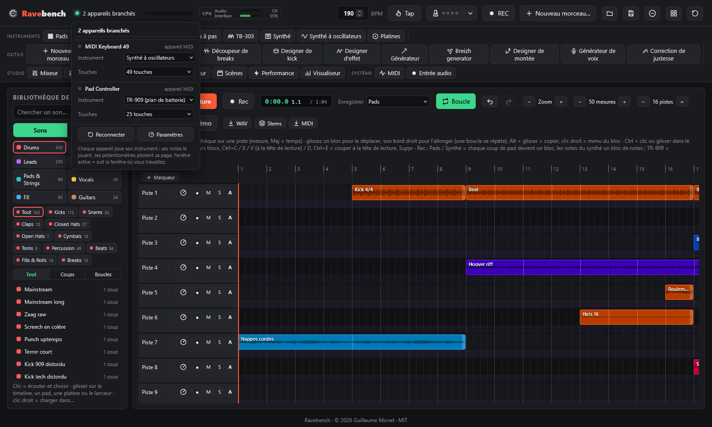

# Le contrôleur APC Key 25

← [Premiers pas](demarrage.md) · [Sommaire](README.md) · [Pads et banques](pads.md) →

Ce que fait chaque bouton de l'APC, les potentiomètres K1-K8 et les effets de performance.

## Commandes sur l'APC

| Contrôle | Action |
|---|---|
| **Pads** | Jouer le son (le dernier pad frappé devient le pad sélectionné) |
| **Maj + pad** | Sélectionner un pad sans le jouer |
| **SCENE LAUNCH 1-5** | Banques 1-5 · **Maj +** SCENE LAUNCH = banques 6-10, puis 11-15, 16-20 et 21-25 à chaque nouvel appui (la LED clignote pour les banques 6 à 25 ; l'écran affiche le numéro de la banque) |
| **Boutons de piste 1 / 2 / 3 / 4** | Page des potentiomètres : Synthé / Effets / Pad sélectionné / EQ |
| **Boutons de piste 5 / 6 / 7 / 8** (maintenus) | Roll 1/8 · Roll 1/16 · Roll 1/32 · Filtre ↓ |
| **Maj + piste 5 / 6 / 7 / 8** | Roll 1/4 · Tape-stop · Filtre ↑ · Pump (marche/arrêt) |
| **Maj + piste 1 / 2 / 3 / 4** | Page de potentiomètres du mixeur : volumes / panos / envois delay / envois reverb (K1 Pads, K2 Synthé, K3 TR-909, K4 Timeline, K5 TB-303, K6 Platines, K7 Synthé à oscillateurs, K8 master) |
| **Potentiomètres K1-K8** | Paramètres de la page en cours, qui suit la fenêtre active (Maj = réglage fin) |
| **SUSTAIN** | Ouvre / ferme la page EQ (maintenu : EQ le temps de l'appui) |
| **Maj + touche blanche** | Preset de la famille du synthé (do = 1er, ré = 2e…) · **Maj + do# / ré#** = famille précédente / suivante · **Maj + fa# / sol# / la#** = type d'accord / arpège oui-non / vitesse de l'arpège |
| **Clavier** | Joue le synthé de la fenêtre active (Synthé ou Synthé à oscillateurs) |
| **PLAY** | Lancer / arrêter la timeline (la TR-909 a son propre ▶ dans sa fenêtre) |
| **Maj + PLAY** | Transformer la grille de pads en TR-909 (et revenir) |
| **REC** | Enregistrer l'outil choisi dans la piste armée de la timeline (et arrêter) · **Maj + REC** = page de potentiomètres TB-303, deux fois = platines |
| **STOP ALL CLIPS** | Coupe tout |
| **Maj + STOP ALL CLIPS** | Transformer la grille de pads en 40 scènes (et revenir) |

**LEDs** : un pad chargé prend sa couleur, et un son en cours est allumé à fond ou clignote. Le mk1 n'a que trois couleurs (rouge, vert, jaune) : ses LED affichent la plus proche, l'écran garde la couleur que vous avez choisie.

Tout se fait aussi à la souris. Sur le clavier de l'ordinateur, la rangée du milieu joue des notes (Q S D F… en AZERTY) et **W / X** changent d'octave.

## Potentiomètres

Il n'y a pas de fenêtre de potentiomètres globale : **chaque instrument a ses potentiomètres dans sa propre fenêtre** (synthé, synthé à oscillateurs, fenêtre des pads et éditeur de pad, TR-909 sous sa grille, TB-303, platines, designer de kick, visualiseur), et la table de mixage a une section **Master** (EQ du master, effets globaux et volumes).

Les 8 potentiomètres de l'APC (K1-K8) pilotent une **page** à la fois :
- la page **suit la fenêtre active** : clic sur la TB-303 et K1-K8 pilotent la TB-303, clic sur la TR-909 et ils pilotent l'instrument choisi de la 909, et ainsi de suite (synthé, synthé à oscillateurs, platines, éditeur de pad, mixeur, visualiseur) ;
- l'indicateur des appareils, en haut à gauche, affiche la page en cours (« 1 appareil branché · Synthé ») ; un clic dessus ouvre la liste des appareils, où le menu **Potentiomètres** de l'APC permet de la choisir ;
- les boutons de piste de l'APC la changent aussi (1-4 = Synthé / Effets / Pad / EQ, Maj + 1-4 = pages du mixeur, Maj + REC = TB-303 puis platines, Maj + PLAY = TR-909, SUSTAIN = EQ).

Le groupe de potentiomètres piloté par l'APC est entouré à l'écran, avec l'étiquette « APC K1-K8 ». Les pages :
- **Synthé** : les 8 potentiomètres d'expression de la famille du synthé (voir Synthé)
- **Effets** : temps, répétitions et envoi du delay, envoi et taille de la reverb, volume du synthé, volume des pads, volume général (section Master du mixeur)
- **Pad** : volume, hauteur, panoramique, filtre, point de départ, envois delay et reverb, et mode de lecture du pad sélectionné (éditeur de pad)
- **EQ** : grave 100 Hz, bas-médium 350 Hz, médium 1,2 kHz, haut-médium 3,5 kHz, aigu 9 kHz (±15 dB), passe-bas, passe-haut, gain de sortie (section Master du mixeur)
- **TR-909**, **TB-303**, **Platines**, **Oscillateurs** (voir Synthé à oscillateurs), **Visualiseur** (vitesse, teinte, flashs, sensibilité, filtres) et les quatre pages du **mixeur**.

Double-clic sur un potentiomètre à l'écran pour le remettre à zéro.

## Appareils branchés

L'indicateur en haut à gauche, à côté du titre, compte les appareils branchés : l'APC Key 25 et les autres appareils MIDI (claviers, contrôleurs). Point vert : au moins un appareil ; point orange : un problème (APC introuvable, port occupé par un autre logiciel, accès MIDI refusé), le détail est dans l'infobulle et dans la liste.

**Un clic dessus ouvre la liste des appareils** :
- une **LED** par appareil, qui s'allume quand il envoie quelque chose : touchez une touche ou un potentiomètre pour vérifier qu'il répond ;
- l'**instrument** associé à chaque appareil : ses notes jouent cet instrument et ses potentiomètres pilotent sa page. Ainsi, sur scène, chaque appareil a son rôle :
  - **Fenêtre active** (par défaut) : comme avant, l'appareil suit la fenêtre où vous travaillez ;
  - **Synthé**, **Synthé à oscillateurs** : les notes jouent ce synthé (avec le mode accords et l'arpégiateur), les potentiomètres sa page ;
  - **Pads** : les notes déclenchent les pads de la banque en cours (do2 = pad 1), pour un contrôleur à pads ;
  - **TR-909** : les notes jouent les instruments de la 909 selon le plan de batterie habituel (36 grosse caisse, 38 caisse claire, 42 charleston fermé, 46 ouvert…) ;
  - **TB-303**, **Platines**, **Mixeur (volumes)** : les potentiomètres pilotent leur page ;
  - **Kick du designer** : les notes jouent le kick du designer, la queue accordée sur la note ;
  - **Rien** : l'appareil ne joue rien (ses commandes apprises restent actives).
- pour l'APC qui suit la fenêtre active, le menu **Potentiomètres** choisit la page de K1-K8. Associé à un instrument, l'APC garde sa page quand vous changez de fenêtre (ses boutons de piste la changent toujours) ;
- **Reconnecter** ferme puis rouvre les ports MIDI, sans débrancher le câble : à essayer quand un appareil ne répond plus ;
- **Paramètres** ouvre la fenêtre MIDI (commandes apprises, horloge MIDI, moniteur).

Les associations sont enregistrées avec le projet, sous le nom de chaque appareil : on les retrouve au prochain branchement.

## Effets de performance

- **Rolls** (répétition) calés sur la grille : la répétition démarre sur la double-croche suivante.
- **Filtre ↓ / ↑** balaie un passe-bas ou un passe-haut sur une mesure tant que vous maintenez.
- **Tape-stop** ralentit tout jusqu'à l'arrêt.
- **Pump** fait s'effacer le synthé à chaque temps.

## Autres claviers MIDI et MIDI learn

L'APC Key 25 n'est pas le seul appareil possible : **n'importe quel clavier ou contrôleur MIDI** branché en USB (sans pilote pour la plupart) est reconnu, en même temps que l'APC. La fenêtre **MIDI** (barre des plugins, groupe Système) les liste.

- **Ses touches** jouent le synthé de la fenêtre active, comme le clavier de l'APC (accords, arpégiateur, enregistrement dans la timeline compris) ; **sa pédale de sustain** tient les notes. Les claviers de 25 à 88 touches sont reconnus (le nombre de touches est lu dans le nom de l'appareil, ou réglé dans la liste des appareils branchés).
- **Changer de son depuis le clavier** : les boutons de son ou de programme d'un clavier (Program Change, avec sa sélection de banque) choisissent un preset de l'instrument que joue l'appareil, dans l'ordre de son menu de presets (ceux tout prêts par catégorie, puis les vôtres ★) : programme 1 = le premier son, programme 2 = le deuxième… Avec la sélection de banque, chaque banque ajoute 128. Un appareil qui joue les pads change la banque affichée ; un appareil qui suit la fenêtre active change le son de l'instrument de la page active. Un message indique le son choisi.
- **MIDI learn** : dans la fenêtre MIDI, cliquez sur **Apprendre** à côté d'une cible, puis tournez un potentiomètre, bougez un fader ou appuyez sur un bouton de l'appareil. Échap annule ; la corbeille retire une assignation.
- **Cibles** : les potentiomètres **K1 à K8 de la page active** (exactement comme ceux de l'APC : synthé, effets, pads, mixeur…), les **faders du mixeur**, le **volume général**, les **volumes des bus**, et le transport : **lecture / arrêt**, **arrêt**, **enregistrer**, **boucle**.
- Une commande ne pilote qu'une cible (la réassigner la retire de l'ancienne). Une touche ou un pad assigné à un bouton ne joue plus de note.
- **Horloge MIDI** : **Envoyer vers** un appareil (boîte à rythmes, séquenceur, autre logiciel) : il reçoit l'horloge (24 impulsions par temps), Start, Stop et la position, et suit la timeline même quand on saute à un marqueur. **Suivre** un appareil : Ravebench prend son tempo et démarre / s'arrête avec lui.
- Les assignations sont enregistrées avec le projet. En bas de la fenêtre, le **moniteur** affiche les derniers messages reçus de chaque appareil.

## Instruments MIDI externes

Une piste de la timeline peut jouer un **instrument MIDI** au lieu des sons de Ravebench : synthé matériel, groovebox, piano numérique ou module de sons, ou un autre logiciel par un câble MIDI virtuel.

- Clic droit sur l'en-tête de la piste › **Instrument MIDI externe…** : choisissez l'**instrument** (les sorties MIDI branchées), sa **voie** (1 à 16) et son **son** : les 128 sons du jeu **General MIDI**, par famille (Piano, Organ, Bass, Strings, Synth Lead, Synth Pad…), compris par la plupart des pianos numériques, claviers et modules de sons ; **Banque** (MSB / LSB) donne accès aux autres banques de sons de l'instrument (voir son manuel). **Note d'essai** joue un do pour l'entendre.
- Les **blocs de notes** de la piste jouent alors sur l'instrument (les blocs audio et les coups de pads de la piste restent joués par Ravebench). Son son part au début de la lecture et dès que vous le changez ; les notes partent à l'heure, calées sur ce que vous entendez ; Arrêt relâche toutes les notes. Un badge **MIDI** signale la piste (clic dessus pour changer les réglages). Une piste muette n'envoie rien.
- Le son de l'instrument ne revient pas tout seul dans Ravebench : pour l'entendre dans le mixage, l'exporter ou le geler, branchez sa sortie audio sur la carte son et enregistrez-la sur une piste (voir Entrée audio dans [Fichiers](fichiers.md)). Les réglages sont enregistrés avec le projet ; un instrument débranché est gardé et revient quand il est rebranché.

---

← [Premiers pas](demarrage.md) · [Sommaire](README.md) · [Pads et banques](pads.md) →
